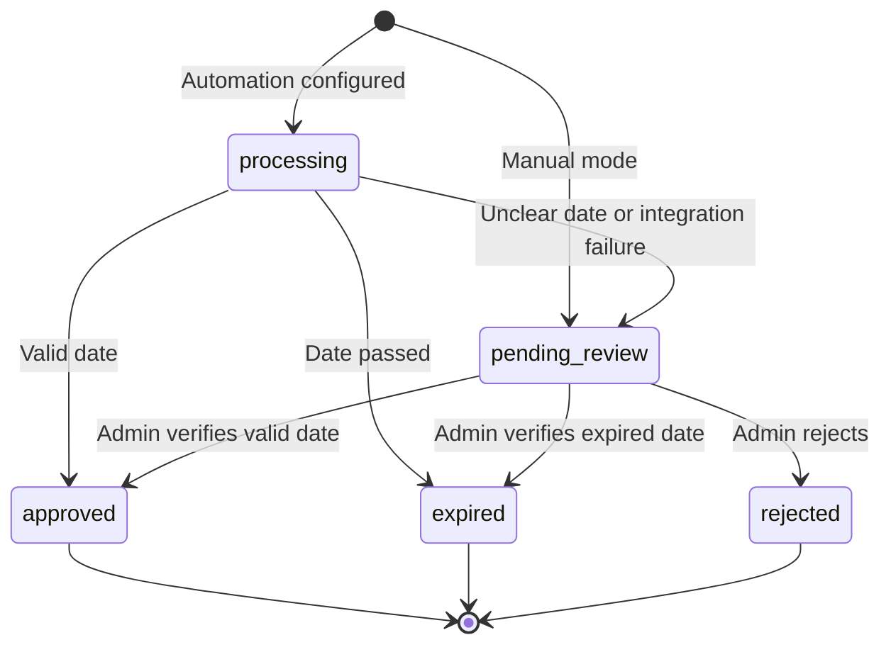

# Architecture

## Boundaries

The npm workspace contains independently deployable Next.js and Express applications. The App Router contains route adapters and layouts; feature screens own their presentation and page state. Shared components contain the workspace shell and table controls. `usePagedResource` centralizes pagination, visible-tab polling, error state and stale-response protection.

The API composes middleware and feature routes in `app.js`. `server.js` owns startup/shutdown. Routes declare authorization and upload middleware, controllers handle HTTP requests, Zod schemas validate account input, the submission review service owns transaction decisions, and integration clients own external HTTP calls. Models live with their domain modules rather than a global model folder.

## Submission lifecycle

OpenAI reads the printed date. n8n compares dates and sends a protected result. The API independently validates the date and comparison, then looks up the submission's actual owner. A transaction updates the submission and creates its unique reward entry atomically. Transactions retry write conflicts; final decisions return their stored result on retries. Rejections only update undecided submissions. Integration failure updates are also conditional on the submission still being `processing`, preserving completed decisions.

## Data and indexes

| Collection  | Responsibility                                             | Important indexes                                     |
| ----------- | ---------------------------------------------------------- | ----------------------------------------------------- |
| users       | Member profile, password hash, role and active state       | Unique email                                          |
| submissions | Uploaded image, date confidence, status, review and points | User/date, status/date, partial unique user/imageHash |
| rewards     | Positive point credits for approved submissions            | Unique submissionId, user/date                        |

Index initialization completes before the API listens. Existing submissions without a hash are covered by the partial index and remain readable. Existing photo URLs are rewritten to protected image routes when queried; the public static upload mount has been removed. Existing files must remain in the configured upload directory. Relocate old `backend/uploads` files to `apps/api/uploads` when upgrading an existing installation, or configure `UPLOAD_DIR` as an absolute persistent path.

## Security and failure behavior

- Session identity is verified on each protected request; suspended users lose access.
- API role checks enforce admin access independently of frontend navigation.
- Images are authenticated and sent with `private, no-store`; other members receive 404.
- Uploads are decoded with Sharp, bounded by bytes/pixels, assigned generated filenames, and fingerprinted. Failed/duplicate saves remove temporary files.
- Browser mutation requests reject untrusted origins. n8n callbacks instead require a constant-time secret comparison.
- API request IDs are returned as `x-request-id` and included in centralized errors.
- Rate limiting uses process memory for a single API instance. A distributed store is required when scaling.
- If OCR or webhook dispatch fails, the submission moves to manual review. If n8n accepts a webhook but never calls back, the record may stay `processing`; administrators can filter and review these records. There is no durable background retry queue.

## Extension points

Add redemption as a separate domain with a debits ledger and transactional balance checks. Add durable jobs before making upload processing asynchronous. Add perceptual duplicate checks or unique product identifiers before relying on the platform for financial incentives. Integrate private object storage before running multiple API replicas.
